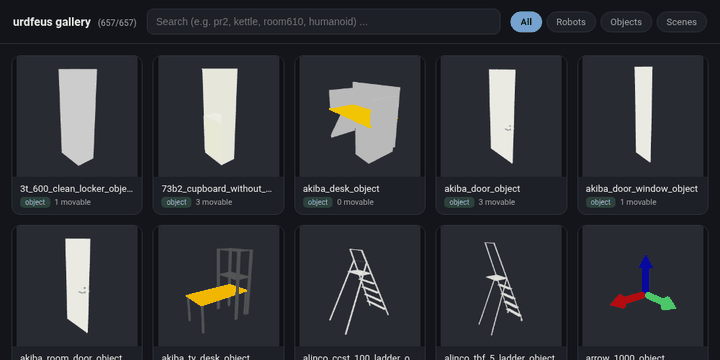
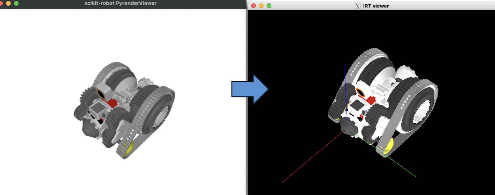

# urdfeus


[](https://github.com/iory/urdfeus/actions)
[](https://doi.org/10.5281/zenodo.23880883)

English | [日本語](https://github.com/iory/urdfeus/blob/main/README.ja.md)

A Python library for converting between URDF and EusLisp, in both directions.

[](https://iory.github.io/urdfeus/)

Every jskeus model (robots, objects and scenes) converted with `eus2urdf` can be browsed, posed and downloaded in the browser → **<https://iory.github.io/urdfeus/>**

## Convert in the browser (no installation)

Convert your own models on the spot → **<https://iory.github.io/urdfeus/convert/>**

`urdfeus` runs as WebAssembly (Pyodide), so there is no Python environment to set up. Conversion happens entirely inside the browser: **your files are never uploaded anywhere**.

### URDF → EusLisp

Drag and drop a URDF and the page lists the meshes it needs; hand them over with "Select files" or "Select directory". Meshes are matched to their `package://` paths by file name, so you can simply select the whole folder that contains them. If the URDF and its meshes live in the same folder, dropping that folder is all it takes.

### EusLisp → URDF

Drop a `.l` file and it is converted to a URDF package and **shown in 3D** right away. Joints can be moved with sliders, and the whole `package.xml` + `urdf/` + `meshes/` set can be downloaded as a zip. Generated models (robots from `euscollada`/`urdfeus`, and jskeus object models) carry their geometry inside the file, so no separate meshes are needed.

**You can also just paste a GitHub URL.** Paste a file page URL (`https://github.com/<owner>/<repo>/blob/<ref>/<path>.l`) and it is rewritten to `raw.githubusercontent.com` and fetched. Dropping the link works too.

Add `?url=` and the page fetches and converts the model as soon as it opens (percent-encode the URL). This makes a model directly shareable:

```
https://iory.github.io/urdfeus/convert/?url=https%3A%2F%2Fgithub.com%2Fowner%2Frepo%2Fblob%2Fmain%2Frobot.l
```

The file is fetched directly by the browser, so only hosts that allow CORS work (GitHub raw does). Other URLs will fail; download the file and drop it instead.

`irteusgl` is a native program and cannot run in the browser. Instead, a [static parser](#eus2urdf-backends) reads the `.l` file directly. Models that build their links in code, and scenes that `load` other files, cannot be read this way; use an [installed](#installation) `eus2urdf` (which goes through irteusgl) for those.

The first visit downloads a Python runtime (about 33 MB), so it takes a few seconds. After that the browser cache kicks in.

Mesh simplification with `--voxel-size` depends on open3d and is not available in the browser.

## Overview

`urdfeus` converts robot description files (URDF) into EusLisp robot model definitions, so that URDF files used in ROS can be used from the EusLisp programming environment.



## Installation

Python 3.10 or later is required.

### With uv (recommended)

[uv](https://docs.astral.sh/uv/) is a fast Python package manager. If you only need the commands, `uv tool` is the most reliable option:

```bash
uv tool install urdfeus
uv tool upgrade urdfeus
```

It installs into an isolated environment, and the shim in `~/.local/bin` points at an interpreter by absolute path, so a checkout in the current directory cannot interfere with it.

To use it as a library, install it into a virtual environment:

```bash
uv venv
source .venv/bin/activate  # Linux/macOS
# .venv\Scripts\activate   # Windows
uv pip install urdfeus
```

With the optional dependencies:

```bash
uv pip install "urdfeus[all]"
```

The open3d pulled in by `[all]` is only installed on Python 3.12 and earlier (open3d does not ship wheels for cp313 and later). On 3.13 and later only `urdfeus` itself is installed, and mesh simplification (`--voxel-size`) is unavailable.

### With uvx (to keep your PATH and environments clean)

If you want a one-off conversion without installing anything, or do not want a shim in `~/.local/bin`, use `uvx`. Each run creates a temporary isolated environment, and nothing but the cache is left behind.

The command names differ from the package name, so `--from urdfeus` is required:

```bash
uvx --from urdfeus urdf2eus robot.urdf robot.l
uvx --from urdfeus eus2urdf robot.l output_package_dir
uvx --from urdfeus urdf2eus --doctor
```

If you need the optional dependencies (e.g. for `--voxel-size`):

```bash
uvx --from "urdfeus[all]" urdf2eus robot.urdf robot.l --voxel-size 0.01
```

To pin a version, write `--from "urdfeus==1.2.1"`. Environment variables such as `ROS_PACKAGE_PATH` are passed through, so `package://` resolution works as usual.

Package resolution runs on every invocation, so for regular use `uv tool install` is the better fit.

### With pip

```bash
pip install urdfeus
```

Avoid `pip install --user`. A stale copy left in `~/.local` can shadow an environment you install later.

### Development version

```bash
git clone https://github.com/iory/urdfeus.git
cd urdfeus
uv pip install -e .   # or: pip install -e .
```

### Relationship to ROS

`urdf2eus` does not need ROS's Python interpreter. As long as `ROS_PACKAGE_PATH` is set so that `package://` in the URDF can be resolved, it runs from an isolated virtual environment:

```bash
export ROS_PACKAGE_PATH=/path/to/your/ros/workspace
urdf2eus robot.urdf robot.l
```

## Reporting bugs

Many bugs turn out to be caused by a mixed-up environment, so please include your environment in reports:

```bash
urdf2eus --doctor
```

It shows which Python, which `urdfeus` and which `scikit-robot` were actually loaded, with their paths as well as their versions. If the conversion succeeds but the result looks wrong, the first 20 lines of the generated `.l` contain the same information.

## Usage

### Command line

```bash
# Basic conversion
urdf2eus robot.urdf robot.l

# Convert together with a YAML file
urdf2eus robot.urdf robot.l --yaml-path robot.yaml

# Use a custom robot name
urdf2eus robot.urdf robot.l --name my_robot

# With mesh simplification
urdf2eus robot.urdf robot.l --voxel-size 0.01
```

### Python

```python
from urdfeus.urdf2eus import urdf2eus

# Convert a URDF file to EusLisp
with open('robot.l', 'w') as f:
    urdf2eus('robot.urdf', fp=f)

# Convert together with a YAML file
with open('robot.l', 'w') as f:
    urdf2eus('robot.urdf', 'robot.yaml', fp=f)

# Use a custom robot name
with open('robot.l', 'w') as f:
    urdf2eus('robot.urdf', robot_name='my_robot', fp=f)
```

## EusLisp → URDF conversion (eus2urdf)

`eus2urdf` is the reverse tool: it converts a EusLisp robot model into a URDF (as a ROS package).
The model is instantiated in `irteusgl` before extraction, so links and joints added procedurally inside `:init` (legs, suction cups and so on) are converted too. Meshes are written from `glvertices` via `trimesh` (`.glb` by default, which preserves colors). The results can be seen in the [gallery](https://iory.github.io/urdfeus/).

### Requirements

- `irteusgl` (jskeus) installed (if it is missing, the static parser described below is used)
- `trimesh` / `pycollada` for writing meshes (included in the dependencies)

### Command line

```bash
# EusLisp model -> complete ROS package (package.xml + urdf/ + meshes/)
eus2urdf robot.l output_package_dir

# Set the package name used in package://
eus2urdf robot.l output_package_dir --package-name my_robot_description

# Set the robot name, constructor and mesh format
eus2urdf robot.l out --name my_robot --constructor my-robot --mesh-format obj
```

Output layout:

```
output_package_dir/
  package.xml
  CMakeLists.txt             # minimal catkin definition (builds with catkin build/catkin_make)
  urdf/<robot>.urdf          # references package://<pkg>/meshes/<link>.glb
  meshes/<link>.glb
```

### Python

```python
from urdfeus.eus2urdf import eus2urdf

urdf_path = eus2urdf('robot.l', 'output_package_dir',
                     package_name='my_robot_description')
```

#### Options

- `--package-name`: ROS package name referenced by `package://` (defaults to the output directory name)
- `--name`: `<robot name>` and the URDF file name (defaults to the robot name the model returns)
- `--constructor`: name of the EusLisp constructor function (defaults to the file name stem)
- `--mesh-format`: any extension `trimesh.export` handles (default `glb`). `glb`/`ply`/`obj` keep per-face colors. With `dae`, trimesh's Collada exporter collapses colors into a texture, so **multi-colored meshes turn gray** (single-colored meshes are kept). `stl` has no color
- `--draco`: Draco-compress glb meshes (`KHR_draco_mesh_compression`). Dense meshes shrink by roughly an order of magnitude while keeping vertex colors. Forces `glb` and requires `DracoPy` (`pip install urdfeus[draco]`). The glTF loader on the reading side needs a Draco decoder
- `--irteusgl`: the `irteusgl` executable to use
- `--backend`: how the model is read (see below)

#### Inertia tensors

EusLisp's `:weight` and `:inertia-tensor` become URDF's `<mass>` and `<inertia>` as they are (`g`→`kg`, `g*mm^2`→`kg*m^2`). However, some jskeus models have mass but an inertia tensor that is not physically valid for a rigid body:

- h3 / h3s / h4 / h6 / h7 / igoid2 / igoid3 / saizo: `:inertia-tensor` is a zero matrix
- macra: a placeholder around 1e-40 (in some links numerical error makes eigenvalues negative)
- human: `1.0` only about the long axis (the other two axes are `2.07e8`, in `g*mm^2`)

A rigid body with mass but no inertia cannot exist, so an importer handed such a link either rejects the body or silently substitutes a default tensor built from the mass, a value that has nothing to do with the robot. urdfeus therefore **recomputes the inertia from that link's mesh at uniform density** when the tensor is not positive definite, when the principal moments violate the triangle inequality, or when it is too small for the mesh size and mass. Mass and center of mass keep their declared values.

Rewritten links are listed in a warning during conversion, and the reason is left as a comment in the URDF:

```xml
<link name="root">
  <!-- inertia recomputed by urdfeus: all-zero inertia tensor -->
  <inertial>
```

For links with no mesh, where nothing can be computed, `<inertial>` is omitted entirely instead of writing an invalid tensor (this is warned about as well).

#### eus2urdf backends

There are two ways to read a model.

| `--backend` | How it reads | Coverage |
| --- | --- | --- |
| `irteusgl` | Instantiates the model in `irteusgl` and dumps it | Reads any model. Requires a EusLisp installation |
| `static` | Parses the `.l` file directly (`urdfeus.eus_parse`) | Generated models only. EusLisp not required |
| `auto` (default) | `irteusgl` if it is on PATH, otherwise `static` | |

`static` reads **generated** models: robots emitted by `euscollada`/`urdfeus` from URDF or collada (geometry held as `gl::glvertices`), and jskeus object models (geometry held as `faceset`). Models that compute their links by hand, and scenes that `load` other files (`*-scene.l`), cannot be read and produce an error saying so (it never silently converts only part of a model).

`static` reproduces EusLisp's coordinate semantics such as `:assoc` and `:newcoords`, and has been verified against `irteusgl` dumps on all 651 jskeus models (641 match exactly, 2 differ only for joints with a positive lower limit and are equivalent as URDF, and 8 are scenes and out of scope).

```bash
# Convert even where EusLisp is not installed
eus2urdf robot.l out --backend static
```

```python
from urdfeus.eus_parse import parse_eus_model

data = parse_eus_model('robot.l')   # no irteusgl needed; returns the same dict as the dump
```

#### Geometry

- Collada bodies are meshed from `glvertices`; plain bodies created by `make-cube` and the like (e.g. leg cubes or suction cups added for visualization in `:init`) are meshed by triangulating each face. Both are written out as meshes.
- Face triangulation of plain bodies assumes convex faces (which holds for primitive shapes).

#### Round-trip (eus -> URDF -> eus) verification

`tests/urdfeus_tests/test_roundtrip.py` converts a model from EusLisp to URDF and back to EusLisp, then compares the `irteusgl` dumps at both ends. Unit and convention mismatches can look plausible when you only check one direction, so the comparison is made after converting back (the factor of 1e9 between `g*mm^2` and `kg*m^2`, degrees vs. radians, mm vs. m, axis signs).

`dump-robot` zeroes every joint before dumping, so what is compared is the full set of kinematic parameters at the zero pose (link poses, joint axes, types and limits). If these match, forward kinematics matches at every other pose as well, so there is no test that sets random joint angles.

Only two things are allowed to change in a round trip. Names: `:torso-waist-y` is sanitized to `torso_waist_y`, so they are matched with the same mapping `eus2urdf` uses. And links whose inertia tensor is not valid for a rigid body come back with the recomputed tensor (links carrying the comment in the URDF are excluded from the inertia comparison).

### Using the generated EusLisp file

```lisp
;; Example in EusLisp
(load "robot.l")
(setq *robot* (robot))  ; the URDF robot name, or the name given with --name
(send *robot* :angle-vector)

;; With a custom name
(load "robot.l")
(setq *robot* (my_robot))  ; when generated with --name my_robot
(send *robot* :angle-vector)
```

### Robot name constraints

The robot name given with `--name` must be a valid EusLisp identifier:

- It starts with a letter or `_`
- It contains only letters, digits, `_` and `-`
- It is not a EusLisp reserved word (`if`, `defun`, `nil`, ...)
- It is not empty and contains no spaces

**Valid**: `my_robot`, `robot-v1`, `MyRobot`, `_robot`, `robot123`
**Invalid**: `123robot`, `robot name`, `robot.name`, `if`, `defun`

## YAML file

A YAML file configures the robot's joint groups, end effectors and predefined poses.

### Example: PR2

Based on the actual [PR2 configuration file](https://github.com/iory/urdfeus/blob/main/tests/urdfeus_tests/pr2.yaml):

```yaml
# Joint groups
torso:
  - torso_lift_joint : torso-waist-z

larm:
  - l_shoulder_pan_joint   : larm-collar-y
  - l_shoulder_lift_joint  : larm-shoulder-p
  - l_upper_arm_roll_joint : larm-shoulder-r
  - l_elbow_flex_joint     : larm-elbow-p
  - l_forearm_roll_joint   : larm-elbow-r
  - l_wrist_flex_joint     : larm-wrist-p
  - l_wrist_roll_joint     : larm-wrist-r

rarm:
  - r_shoulder_pan_joint   : rarm-collar-y
  - r_shoulder_lift_joint  : rarm-shoulder-p
  - r_upper_arm_roll_joint : rarm-shoulder-r
  - r_elbow_flex_joint     : rarm-elbow-p
  - r_forearm_roll_joint   : rarm-elbow-r
  - r_wrist_flex_joint     : rarm-wrist-p
  - r_wrist_roll_joint     : rarm-wrist-r

head:
  - head_pan_joint  : head-neck-y
  - head_tilt_joint : head-neck-p

# End-effector coordinates
larm-end-coords: 
  parent : l_gripper_tool_frame
  rotate : [0, 1, 0, 0]

rarm-end-coords:
  parent : r_gripper_tool_frame
  rotate : [0, 1, 0, 0]

head-end-coords:
  translate : [0.08, 0, 0.13]
  rotate    : [0, 1, 0, 90]

# Predefined poses
angle-vector:
  reset-manip-pose : [300.0, 75.0, 50.0, 110.0, -110.0, -20.0, -10.0, -10.0, -75.0, 50.0, -110.0, -110.0, 20.0, -10.0, -10.0, 0.0, 50.0]
  reset-pose : [50.0, 60.0, 74.0, 70.0, -120.0, 20.0, -30.0, 180.0, -60.0, 74.0, -70.0, -120.0, -20.0, -30.0, 180.0, 0.0, 0.0]
```

### What group definitions give you

Once groups are defined in the YAML file, methods like the following become available in EusLisp:

```lisp
;; PR2 example
(setq *robot* (pr2))

;; Get the current joint angles of the right arm
(send *robot* :rarm :angle-vector)
;; => #f(-60.0 74.0 -70.0 -120.0 -20.0 -30.0 180.0)

;; Get the right arm's joint list
(send *robot* :rarm :joint-list)
;; => (#<rotational-joint r_shoulder_pan_joint> 
;;     #<rotational-joint r_shoulder_lift_joint> ...)

;; Get the joint names
(send-all (send *robot* :rarm :joint-list) :name)
;; => ("r_shoulder_pan_joint" "r_shoulder_lift_joint" 
;;     "r_upper_arm_roll_joint" "r_elbow_flex_joint" ...)

;; Set the right arm's joint angles
(send *robot* :rarm :angle-vector #f(0 0 0 -90 0 0 0))

;; Use a predefined pose
(send *robot* :reset-pose)
```

### Configuration reference

#### Joint groups
- `group name`: name of the body part (rarm, larm, head, ...)
- `joint name : EusLisp joint name`: mapping from the URDF joint name to the joint name in EusLisp

#### End-effector coordinates
- `parent`: parent link the coordinates are attached to
- `translate`: [x, y, z] translation (meters)
- `rotate`: [x, y, z, angle] rotation axis vector and angle (degrees)

#### Predefined poses
- `angle-vector`: pose names and their joint angle lists
- Joint angles are in degrees
- Joint order follows the order in which the joint groups are defined in the YAML file

## Dependencies

- Python 3.10+
- scikit-robot
- trimesh
- numpy

## Citation

If you use urdfeus in your research, please cite it. The DOI below always resolves to the latest version on [Zenodo](https://doi.org/10.5281/zenodo.23880883), where each release also has its own DOI. GitHub's "Cite this repository" button gives the same information in other formats.

```bibtex
@software{urdfeus,
  author    = {Yanokura, Iori and Matsuo, Kento and Yamaguchi, Naoya},
  title     = {urdfeus: URDF ⇄ EusLisp converter},
  publisher = {Zenodo},
  doi       = {10.5281/zenodo.23880883},
  url       = {https://doi.org/10.5281/zenodo.23880883}
}
```

## License

MIT License

## Contributing

Pull requests and issue reports are welcome.

## Related projects

- [scikit-robot](https://github.com/iory/scikit-robot) - Python robot modeling library
- [EusLisp](https://github.com/euslisp/EusLisp) - Lisp-based robot programming language
